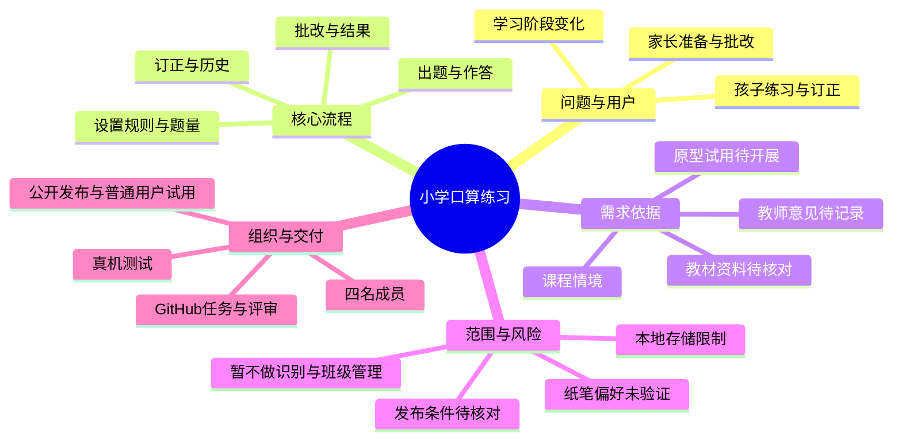

# 小学口算练习微信小程序——项目立项与 NABCD 分析

版本：v0.3.1｜更新日期：2026-10-16｜状态：立项完善稿，功能方案及建议分工待小组评审。本次补充实施计划引用，FR01—FR07 和 AC01—AC06 不变。

项目仓库：[sensei2168/software-engineering-project](https://github.com/sensei2168/software-engineering-project)。

## 1. 项目概况与当前进展

本项目采用软件工程课程参考选题二“儿童学习”，面向小学一至三年级学生及家长，计划开发微信小程序，提供“设置练习—按规则出题—输入答案—自动批改—订正与查看记录”的口算练习流程。核心问题是减少课程情境中家长反复准备题目和核对答案的操作。

| 项目 | 当前情况 |
|---|---|
| 项目名称 | 小学口算练习微信小程序（工作名称；正式名称待确定） |
| 组长 | 袁嘉亮 |
| 组员 | 闫心如、何顺、彭方鑫 |
| 产品形式 | 微信小程序，已由组长确认选择 |
| 项目记录平台 | GitHub，已建立仓库并上传初步资料与任务模板 |
| 需求获取方式 | 本阶段不安排家长访谈；拟通过课程材料、教材资料、同类工具分析、教师审阅和原型试用细化需求 |
| 已形成的材料 | 立项及 NABCD 草稿、需求调研与验证计划、协作记录、GitHub 使用说明 |
| 尚待完成 | 小组评审、真实会议材料、题型依据核对、原型、实现、测试和公开发布 |
| 课程截止日期 | 待补充；阶段计划不等于已确定日程 |

“已确认”仅表示有课程文本或组长明确答复支持；“方案”“暂定”“建议”表示供小组评审的设计选择。本稿没有真实家长调查结果、已完成的教师审阅结论或软件测试结果。

## 2. 需求来源与证据边界

| 来源编号 | 来源 | 支持的内容 | 证据状态 |
|---|---|---|---|
| S01 | 用户提供的选题文本及《软件工程实践课程教案》“儿童学习”选题 | 出题与批改负担；情境题量每天 30 道；希望使用三年；必须最终发布供普通用户在线试用 | 已核对课程文本；不是家庭调查结果 |
| S02 | 组长选择选题二，并回复“希望做微信小程序” | 选题和产品形式 | 已确认选择 |
| S03 | 组长早期回复“暂时没有，需要先列出访谈问题” | 曾计划先准备家长访谈提纲 | 历史条件；当前计划以 S07 为准 |
| S04 | 《Ch3-如何获取用户的真实需求》课件第 27、31、32 页 | 明确需求获取对象、保留事实依据、整理和确认需求的分析方法 | 已核对课件；不能作为本项目已完成访谈的证据 |
| S05 | 教案第一次课及附录“项目立项”“进度计划” | 立项过程、参会者与角色、时间、照片、思维导图、NABCD；后续任务分解和甘特图 | 已核对课程文本 |
| S06 | 组长提供 GitHub 地址；2026-10-16 读取远程 main 分支 | 项目采用 GitHub；远程已有 README、4 份资料及任务模板 | 已确认选择；已核对文件，读取基点 80db3e4 |
| S07 | 组长说明“我们大概是不会进行家长访谈，或者说没渠道，这方面改一下” | 本阶段取消家长访谈任务及其前置依赖 | 已确认条件；替代验证方法仍需执行 |
| S08 | 组长提供“袁嘉亮（我），闫心如，何顺，彭方鑫”；此前说明自己担任组长 | 四名成员姓名及组长身份 | 已确认；具体分工和 GitHub 用户名待确认 |
| A01 | AI 根据课程情境和小组基础提出的方案 | 在线作答、规则出题、错题订正、本地记录及范围控制 | 建议，尚未逐项经小组或真实目标用户确认 |

本项目与个人实验“益智消除游戏”分开管理，其需求编号、计算核实及设计文档不作为本项目证据。课程材料中的 Gitee 表述保留为历史来源，项目按组长选择使用 GitHub 组织过程资料。

后续证据按“来源名称／版本或日期／页码或链接／实际观察／支持的需求编号”记录。教材资料只能支持题型与规则选择；同学试用只能支持操作流程评价，不能推出真实家长愿意使用或孩子学习成绩提升。

## 3. 背景、目标用户与使用场景

### 3.1 背景与问题

课程情境中，家长每天准备和批改口算题，存在重复劳动；孩子学习阶段改变后，题型与数值范围也需要调整。项目拟将这两个问题转化为可实现的目标：按明确规则快速生成练习，按标准答案可靠批改，并允许调整练习内容。

“每天 30 道”用作初始默认题量，不能写成所有家庭的共同习惯。家长是否需要自行出题、倾向纸笔还是手机、现有工具是否足够好，仍缺少真实家庭证据。在线作答是当前实施方案，需要在教师讨论和后续反馈中评审。

### 3.2 用户与边界

| 用户／参与者 | 主要任务 | 首版边界 |
|---|---|---|
| 家长 | 设置题型、范围和题量；查看结果与错题；选择是否订正 | 家长视角与孩子视角属于同一小程序流程，暂不建立独立账号权限体系 |
| 小学一至三年级学生 | 在家长安排下作答、修改未提交答案、订正错误 | 界面清楚、步骤少；不以排名、付费或持续在线时长为目标 |
| 教师 | 对题型规则、项目范围和课程交付提供意见 | 作为评审参与者，首版不建设教师端、班级或作业管理功能 |

“支持三年使用”拟通过可调整的运算类型与数值范围实现。最终版本计划支持整数加、减、乘、除的分阶段练习，但年级与题型的映射要有教材或教师依据；不能据此宣称覆盖全部一至三年级课程或验证了三年的学习效果。

### 3.3 候选场景

1. **准备练习：**家长选择一种运算类型、受支持的范围和题量，检查说明后生成练习。
2. **完成练习：**孩子逐题输入答案，提交前可以返回修改；未作答题目有明确标记。
3. **查看与订正：**提交后看到总题数、正确数、错误数、未答数和逐题结果，对错误或未答题启动一次订正练习。
4. **中断与恢复：**切换应用或退出后重新进入，若有成功保存的未完成练习，询问继续还是放弃；保存失败时明确提示。

以上是待评审场景，不是已观察到的家庭行为。

## 4. 需求获取与验证安排

当前没有家长访谈渠道，不把联系家长作为立项、原型或开发的必经前置任务。采用以下计划，记录模板见[需求调研与验证计划](02_需求调研与验证计划.md)。

| 方法 | 计划执行的工作 | 形成的证据 | 当前状态与限制 |
|---|---|---|---|
| 课程材料核对 | 提取问题、目标用户、交付形式及过程要求 | S01、S04、S05 及本稿来源表 | 已完成文本核对；仅支持课程设定 |
| 教材／公开教学资料整理 | 核对题型、数值范围、进退位、乘除和例题，记录版本及页码 | 题型规则对照表，关联 FR01、FR02 | 待开展；不把 AI 年级划分当教材结论 |
| 同类工具分析 | 计划选取 2 个可实际访问的工具，对比设置、作答、批改和记录流程 | 名称、日期、功能出处或实际操作记录 | 待开展；宣传内容与亲自试用分开记录 |
| 教师审阅 | 讨论在线作答方案、三年使用的范围、题型规则和发布验收 | 日期、实际意见、修改决定及影响编号 | 待记录；不预填老师同意或认可 |
| 原型试用 | 原型完成后，计划邀请至少 3 名未参与该页面设计的同学完成同一组任务 | 完成情况、耗时、误操作和改进记录 | 待开展；不能替代家长／儿童的使用验证 |

优先验证的假设：H01 在线作答适合所选课程场景；H02 规则配置能支持不同阶段练习；H03 错题和历史值得纳入首版；H04 所选账号能按实际功能完成公开发布。无法验证的假设保留为限制，不因为开始开发就自动标为成立。

## 5. 目标、首版范围与验收目标

### 5.1 项目目标

- **G01 核心流程完整：**可以完成设置、出题、作答、提交和查看结果。
- **G02 规则与批改可信：**生成题目符合选定规则；标准答案与独立核算结果一致。
- **G03 内容可调整：**通过题型和范围配置支持学习阶段变化，题型依据可追溯。
- **G04 过程可检查：**成员、任务、决策、修改及测试证据能在仓库中找到。
- **G05 产品可试用：**最终发布后，普通用户能够访问并完成一次核心流程。

### 5.2 功能范围

沿用 v0.2 的 FR01—FR07 编号。以下为首版提案：高优先级构成核心交付，中优先级安排在核心流程稳定后、正式交付前完成；低优先级暂缓。范围调整应更新本表和变更记录。

| 编号 | 功能及候选规则 | 优先级／阶段 | 验证目标 | 来源 |
|---|---|---|---|---|
| FR01 | 设置一种运算类型、已支持的范围和题量；暂定题量 10—50 道整数，默认 30 道 | 高／核心 | 合法配置可生成练习；空值、越界值和不支持的组合有提示 | S01、A01；参数待评审 |
| FR02 | 按配置生成题目及标准答案；先实现加减法，再补齐整数乘法和整除规则 | 高／核心；最终首版包含四类规则 | 每题满足配置；减法结果非负，除数非零，整除题无余数 | S01、A01；年级映射待教材核对 |
| FR03 | 手机输入整数答案，提交前可修改；标记未答题；保存未完成练习并提供继续／放弃选择 | 高／核心 | 修改正确生效；中断恢复已成功保存的答案；异常保存有提示 | A01；手机作答仍是待验证假设 |
| FR04 | 一次提交形成一次结果，显示正确／错误／未答统计及标准答案 | 高／核心 | 总题数等于三类数量之和；空白不当成 0；重复点击不重复记入历史 | S01、A01 |
| FR05 | 将本次错误及未答的原题组成一次订正练习，独立保存结果 | 中／完善 | 订正题来源正确；没有待订正题时解释原因；不覆盖原练习结果 | A01 |
| FR06 | 本设备查看历史练习日期、题量、正确数和逐题结果，支持确认后清除记录 | 中／完善 | 重新进入后能读到成功保存的记录；清除前确认且不误清正在进行的练习 | A01；暂定仅保留最近 100 次已提交练习 |
| FR07 | 额外鼓励动画或可关闭音效 | 低／暂缓 | 若后续采纳，再补充可关闭、无阻塞及反馈内容的验收规则 | A01；基本文字结果已由 FR04 覆盖 |

首版暂不包含：拍照识别手写答案、语音识别、混合运算、带余数除法、小数与负数练习、付费课程、公开排行榜、社交聊天、班级管理、多孩子账号、跨设备同步和纸质导出。若教师认为纸笔练习是本项目的核心场景，应重新评审 FR03、FR04 与交付计划，再决定替换或增加流程。

### 5.3 关键规则提案

- 每轮使用一种运算类型；规则模板分别注明操作数范围、结果范围、是否允许进退位。未经核对的模板不标为适合某年级。
- 单轮默认不重复相同算式；加法和乘法中仅交换两个操作数视为重复。若合法题不足，提示减少题量或调整规则，不无限重试，也不私自扩大范围。
- 正式提交前仅显示作答进度，不显示标准答案。空白显示“未作答”；非整数输入提示修改。提交时若存在空白，先确认是否仍要提交。
- 正确率按“正确题数 ÷ 总题数 × 100%”计算，显示一位小数；错误数不包含未答数，避免统计口径不一致。
- 订正产生独立记录并关联原练习，题量等于所选原练习的错误及未答题数量（1—50 道），不受新建练习至少 10 道的限制。历史保留上限包含正常练习及订正练习，超限删除最早记录；原记录被删除后，订正记录仍保留自身题目与结果。
- 暂定使用本设备存储，不建设自有账号或云端业务数据库；不要求儿童姓名、学校、手机号或位置信息。清理微信数据、换设备等情况可能无法保留记录，界面需说明本地存储范围。
- 规则出题及批改使用确定的数学算法；AI 用于辅助开发和审阅，不作为运行时计算标准答案的必要依赖。

### 5.4 质量与验收目标

以下是尚未实测的目标，最终测试须记录手机型号、系统、微信版本、构建版本及实际结果。

| 编号 | 建议目标 | 验证方法 |
|---|---|---|
| AC01 功能正确 | 完整执行 FR01—FR06；正确／错误／未答及订正结果均符合定义 | 用例覆盖正常、边界及异常路径，人工核对预期结果 |
| AC02 数学正确 | 对每个支持的规则模板分多轮核算边界样例及累计至少 1,000 道生成题，跨轮可重复，未发现算式、范围或答案错误 | 独立参考计算及规则检查，不能用生成器自身答案作为唯一依据 |
| AC03 响应速度 | 在记录的测试手机上，30 题生成与批改分别连续执行 20 次，每次不超过 1 秒 | 从操作触发到题目／结果可见计时；不把该值写成首次启动时间 |
| AC04 中断与保存 | 10 组正常中断／恢复检查无已成功保存答案丢失；重复提交只保留一份结果 | 覆盖返回、切换应用、重新进入及保存失败；不承诺失败写入可恢复 |
| AC05 易用性 | 计划至少 3 名同学在首次试用时，均能在 2 分钟内独立完成“设置—生成—答完 3 题”任务 | 记录是否求助、误操作和耗时；仅为早期流程检查，不是儿童易用性结论 |
| AC06 发布 | 正式发布后至少 1 名未加入开发或体验名单的普通用户完成核心流程 | 保存发布日期、入口、版本和实际操作记录；开发工具截图不替代证据 |

## 6. NABCD 分析

### N：Need——解决什么需求

核心需求是减少家长为日常口算练习准备题目和核对答案的重复操作。次要需求是让练习内容随学习阶段调整，并便于查看和订正错误。该判断以课程情境为起点，目前尚无家庭样本证明它是普遍或最迫切的问题。

### A：Approach——怎样解决

采用微信小程序提供短流程：选择规则和题量，生成练习，输入答案，提交后统一批改，再按需订正或查看历史。先完成可靠的出题与批改，再增加复习功能。候选技术方案为原生小程序界面、独立数学规则模块和本地记录，不在首版引入复杂账号、云同步或图像识别；技术选型仍须结合原型与发布条件评审。

### B：Benefit——预期带来什么好处

| 对象 | 预期收益 | 如何检查，及结论限制 |
|---|---|---|
| 家长 | 减少逐题准备和核对答案的操作；集中看到错误与未答题 | 后续用同一任务比较手工准备／核对与工具辅助所需时间；未测量前不填写节省比例 |
| 孩子 | 清楚知道题目、作答进度及需要订正的内容 | 先检查界面与反馈是否可理解；无儿童试用和长期数据时，不声称提升成绩或学习兴趣 |
| 小组与课程 | 形成范围可控、可公开试用、过程可追溯的完整作品 | 检查需求、原型、实现、测试、发布记录及成员贡献 |

### C：Competitors——现有替代方案与取舍

以下为替代方式分析，不是已经完成的具体产品评测。具体工具名称、版本、页面及实际结果将在调研记录中补充。

| 替代方式 | 可以满足的需求 | 本项目需要考察的差异 |
|---|---|---|
| 家长手写题与人工批改 | 题目内容可自行控制，直接使用纸笔 | 实际准备与核对耗时是否足以构成换用工具的理由 |
| 纸质口算练习册 | 提供现成题目，适合纸笔练习 | 家庭是否更重视纸笔习惯；是否还需要额外出题与结果记录 |
| 已有口算练习软件／小程序 | 可能已有出题、批改或练习记录能力 | 实际支持哪些功能、步骤是否清楚、是否限制使用；不能预设其操作复杂或收费 |

本项目拟以规则清楚、操作集中、结果可检查作为设计重点。尚无证据证明它比现有工具更好；如果调研发现已有方案已满足需求，仍应据实记录，把本项目定位为课程实践作品，避免虚构市场优势。

### D：Delivery——怎样交付与推广

完成测试和正式发布后，在 README 提供小程序名称、访问入口或二维码、版本和简短说明，供教师、同学及其他自愿用户试用。可通过课程展示介绍核心流程并收集实际问题；不把“已有家长渠道”作为推广前提，也不预填用户规模、满意度或收入。公开入口的最终可用性按 AC06 验证。

## 7. 可行性、技术边界与主要风险

小组基础较弱，项目采用先打通最小流程、再逐步完善的方式。题目生成和批改规则可拆分为独立模块测试；不依赖运行时大模型，也不将复杂识别能力列为交付前提。现阶段只有实现方案，尚无已完成的原型或性能证据。

| 风险 | 影响 | 处理方式与检查节点 |
|---|---|---|
| 缺少家长／儿童验证 | 可能选错答题方式、字号或功能优先级 | 保留 H01—H03；原型评审时请教师指出场景偏差；有真实反馈后再调整，不将同学反馈推广到家庭 |
| 题型与学习阶段不匹配 | “支持三年使用”缺乏依据 | 需求阶段建立题型资料表；没有依据的模板不标年级 |
| 发布条件尚未核对 | 开发完成后仍可能无法公开交付 | 在原型前安排账号主体、服务类目和实际适用发布要求的核对；记录办理事项与周期 |
| 范围过大、AI 代码难以理解 | 任务堆积，成员无法维护或说明实现 | 先交付加减法闭环，再扩展；每名成员理解并演示自己负责的修改 |
| 本地数据丢失或写入失败 | 历史／进度不可恢复 | 提示存储范围和写入失败；保留当前可操作状态；不显示虚假的保存成功 |
| 时间及人员分工未定 | 无法形成可执行日程 | 组长补齐截止日期与成员确认，再排任务、依赖和甘特图 |

发布核对入口：[微信公众平台](https://mp.weixin.qq.com/)。应以实际账号后台及当前官方要求记录主体、类目、备案等适用事项，以及提交、审核和发布步骤。本文未确认任何账号资格或审核结果，不承诺账号一定满足上线条件；核对任务不能延后到编码全部完成之后。

## 8. 成员与建议分工

四名成员及组长身份来自 S08。**以下工作分配为建议，尚未取得全体成员确认；GitHub 用户名和任务期限待补充。**

| 姓名 | 当前身份 | 建议负责的主要工作 | 建议交付证据 | GitHub 用户名 |
|---|---|---|---|---|
| 袁嘉亮 | 组长 | 组织评审、维护需求与计划、协调接口与集成、汇总发布准备 | 决策记录、Issues、集成检查、汇报资料 | 待补充 |
| 闫心如 | 组员 | 题型资料整理、场景及原型、练习设置页面 | 来源表、原型、页面代码与自测记录 | 待补充 |
| 何顺 | 组员 | 出题与批改规则、答题流程及异常处理 | 规则模块、答题页面、数学正确性与边界测试 | 待补充 |
| 彭方鑫 | 组员 | 结果与历史记录页面、存储、整体验证及发布协助 | 页面与存储代码、测试记录、发布检查材料 | 待补充 |

成员应共同评审需求，每人完成自己模块的实现、解释和自测；跨模块验证交叉进行。实际认领后，再将任务负责人写入 Issues，不能把本表建议当作已完成的工作量证明。

## 9. 阶段计划与首批任务

详细的实现步骤、建议分工、交付物和完成条件见[项目实施计划与分工](05_项目实施计划与分工.md)。下表 M1—M6 按课程过程划分，实施计划 P1—P6 按实现工作划分；两者的对应关系见实施计划第 2 节。计划草案已经形成，实际认领、日期与执行状态仍待补充。

| 阶段 | 工作 | 完成标志 | 前置条件／时间 |
|---|---|---|---|
| M1 立项评审 | 确认范围、分工、截止时间，补真实会议材料 | 本稿评审意见、成员确认、照片及讨论图 | 当前阶段；具体日期待补充 |
| M2 需求与原型 | 整理题型资料，核对发布条件，制作主要页面与流程 | 编号化需求、来源表、可演示原型、账号核对记录 | 基于 M1；日期待补充 |
| M3 最小流程 | 加减法配置、出题、作答、批改与中断恢复 | 可运行演示及核心规则测试 | 规则明确；日期待补充 |
| M4 首版完善 | 补充乘法、整除、订正、历史及异常提示 | FR01—FR06 与规则模板覆盖检查 | M3 稳定；日期待补充 |
| M5 测试与发布 | 真机检查、问题修复、正式发布和普通用户验证 | AC01—AC06 结果及公开入口 | 实际发布条件满足；预留审核和修改时间 |
| M6 课程汇报 | 整理报告、贡献、演示与项目限制 | 报告和可访问证据链 | 课程截止日期待补充 |

首批任务提案如下，尚不代表已经在 GitHub 上创建或认领。

| 任务编号 | 工作 | 建议牵头人（待确认） | 完成条件 |
|---|---|---|---|
| T01 | 组织立项讨论并补充成员信息 | 袁嘉亮 | 记录实际时间、参与者、决定、分工与截止时间 |
| T02 | 建立题型规则资料表 | 闫心如 | 每条候选规则有出处、例题、适用限制及待确认项 |
| T03 | 对比同类工具的核心流程 | 闫心如 | 至少 2 个工具有可追溯的资料／实测记录，不虚构优缺点 |
| T04 | 记录教师意见并更新范围 | 袁嘉亮 | 记录真实反馈、采纳决定和影响的 FR 编号；未反馈则保持待办 |
| T05 | 核对账号和发布条件 | 袁嘉亮、彭方鑫 | 列明实际账号条件、缺项、负责人和办理计划；不上传凭据 |
| T06 | 明确出题和批改规则 | 何顺 | 规则表及正确／错误／空白、候选题不足等预期样例 |
| T07 | 制作并评审交互原型 | 闫心如、彭方鑫 | 覆盖设置、答题、结果、订正和历史，记录试用问题 |
| T08 | 分解开发任务和日程 | 袁嘉亮，全员认领 | 根据课程要求形成不少于 30 个有意义的任务和甘特图，落实到个人 |

T01—T08 是立项阶段的工作包，不等于后续完整的 30 项开发计划。本次没有编造开会日期、完成日期或 Issue 编号。

## 10. 立项会议与思维导图

课程要求记录真实立项过程。当前只有文档方案；下面的空项和导图用于组织讨论，不能当作已经开会的证据。

| 会议字段 | 真实记录 |
|---|---|
| 实际时间、地点／方式 | 待补充 |
| 实际参会者、主持人、记录人及角色 | 待补充，不能直接用成员名单替代参会记录 |
| 实际讨论的候选方案与取舍理由 | 待补充 |
| 已通过的决定与未决问题 | 待补充 |
| 教师实际意见（如有） | 待补充 |
| 后续责任人、截止时间 | 待补充 |
| 会议照片、原始记录链接 | 待补充真实材料 |

以下是 AI 辅助整理的**讨论用思维导图**，不是会议产物。实际会议后依据讨论修订并注明时间与人员。

图的文字概要：围绕“问题与用户、核心流程、需求依据、范围与风险、组织与交付”五个分支讨论，防止只罗列功能而遗漏证据、限制和交付条件。

## 11. 本轮变更记录与待确认事项

| 变更编号 | 相对 v0.2 的变化 | 理由与依据 | 影响 |
|---|---|---|---|
| CH01 | 取消必须开展家长访谈的任务，增加资料、教师和原型验证计划 | S07：缺少渠道，不再把访谈作为计划前提 | 第 2、4、6、7、9 节；README 与调研文档 |
| CH02 | 补充四名成员和组长身份；提出可评审的分工 | S08；降低任务责任不清的风险 | 第 8、9 节；README |
| CH03 | 保留 FR01—FR07 编号，细化参数、订正与本地历史；暂缓额外音效动画 | A01 的范围控制建议，尚待小组评审 | 第 5 节；不是新增已验证的用户结论 |
| CH04 | 增加验收目标、里程碑、风险和讨论用思维导图 | S05 过程要求及可检查交付的需要 | 第 5、7、9、10 节；目标不是测试成绩，导图不是会议证据 |
| CH05 | 核对远程已上传文件，纠正“仓库只有 README”“尚未上传”的过时描述 | S06：本次读取远程 main 分支 | README、协作记录和 GitHub 使用说明 |
| CH06 | v0.3.1 增加六阶段实施计划入口及阶段对应说明 | 组长要求将讨论形成的项目规划加入 GitHub | 第 9、12 节及相关导航；不改动 FR01—FR07、AC01—AC06，不代表分工和日程已确认 |

下次小组／教师讨论需确认：在线答题方案、首版四类题型及范围、FR01 的题量区间、FR06 的保留数量、FR05／FR06 的优先级、是否需要纸质导出、各成员实际分工、截止日期及发布条件。确认后记录提出者、日期、采纳理由和受影响编号，再形成后续需求基线。

## 12. 资料导航

- [项目首页与成员信息](../README.md)
- [需求调研与验证计划](02_需求调研与验证计划.md)
- [项目实施计划与分工](05_项目实施计划与分工.md)
- [AI 协作与核实记录](03_AI协作与核实记录.md)
- [GitHub 项目记录使用说明](04_GitHub项目记录使用说明.md)
- [历史家长访谈提纲（当前不执行）](02_家长访谈提纲与记录表.md)
