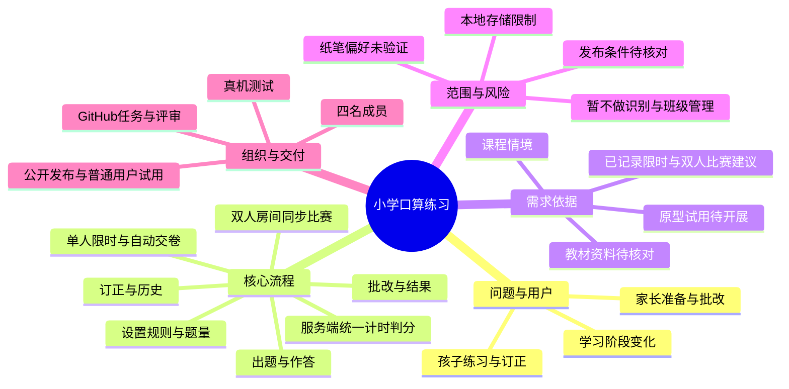

# 小学口算练习微信小程序——项目立项与 NABCD 分析

版本：v0.4｜更新日期：2026-10-23｜状态：根据组长转述的教师反馈，纳入限时与双人在线比赛。具体参数、建议分工与日程待小组确认；尚无实现和实测结果。

项目仓库：[sensei2168/software-engineering-project](https://github.com/sensei2168/software-engineering-project)。

## 1. 项目概况与当前进展

本项目采用软件工程课程参考选题二“儿童学习”，面向小学一至三年级学生及家长，计划开发微信小程序，提供“设置练习—按规则出题—输入答案—自动批改—订正与查看记录”的流程，减少家长反复准备题目和核对答案的操作。根据本轮教师建议，增加单人限时练习和两个学生同时在线比赛，保留普通不限时练习。

| 项目 | 当前情况 |
|---|---|
| 项目名称 | 小学口算练习微信小程序（工作名称；正式名称待确定） |
| 组长 | 袁嘉亮 |
| 组员 | 闫心如、何顺、彭方鑫 |
| 产品形式 | 微信小程序，已由组长确认选择 |
| 项目记录平台 | GitHub，已建立仓库并上传初步资料与任务模板 |
| 需求获取方式 | 本阶段不安排家长访谈；拟通过课程材料、教材资料、同类工具分析、教师审阅和原型试用细化需求 |
| 已形成的材料 | 立项及 NABCD 草稿、调研与验证计划、更新后的实施计划与分工、教师反馈与变更记录、协作记录和 GitHub 使用说明 |
| 本轮教师意见 | 组长反馈已讨论，建议增加限时功能和双人在线答题比赛；具体规则未逐项确认 |
| 尚待完成 | 小组评审、真实会议材料、题型依据核对、原型、实现、测试和公开发布 |
| 课程截止日期 | 待补充；阶段计划不等于已确定日程 |

“已确认”仅表示有课程文本或组长明确答复支持；“方案”“暂定”“建议”表示供小组评审的设计选择。已记录的教师意见限于 S09 的两个方向，不代表所有题型、参数和功能都已审阅；没有真实家长调查或软件实测结果。

## 2. 需求来源与证据边界

| 来源编号 | 来源 | 支持的内容 | 证据状态 |
|---|---|---|---|
| S01 | 用户提供的选题文本及《软件工程实践课程教案》“儿童学习”选题 | 出题与批改负担；情境题量每天 30 道；希望使用三年；必须最终发布供普通用户在线试用 | 已核对课程文本；不是家庭调查结果 |
| S02 | 组长选择选题二，并回复“希望做微信小程序” | 选题和产品形式 | 已确认选择 |
| S03 | 组长早期回复“暂时没有，需要先列出访谈问题” | 曾计划先准备家长访谈提纲 | 历史条件；当前计划以 S07 为准 |
| S04 | 《Ch3-如何获取用户的真实需求》课件第 27、31、32 页 | 明确需求获取对象、保留事实依据、整理和确认需求的分析方法 | 已核对课件；不能作为本项目已完成访谈的证据 |
| S05 | 教案第一次课及附录“项目立项”“进度计划” | 立项过程、参会者与角色、时间、照片、思维导图、NABCD；后续任务分解和甘特图 | 已核对课程文本 |
| S06 | 组长提供 GitHub 地址；2026-10-16 读取远程 main 分支 | 项目采用 GitHub；远程已有 README、4 份资料及任务模板 | 已确认选择；已核对文件，读取基点 80db3e4 |
| S07 | 组长说明“我们大概是不会进行家长访谈，或者说没渠道，这方面改一下” | 本阶段取消家长访谈任务及其前置依赖 | 已确认条件；替代验证方法仍需执行 |
| S08 | 组长提供“袁嘉亮（我），闫心如，何顺，彭方鑫”；此前说明自己担任组长 | 四名成员姓名及组长身份 | 已确认；具体分工和 GitHub 用户名待确认 |
| S09 | 2026-10-23 组长反馈已与老师讨论，老师建议增加限时及两个学生同时在线比赛答题，并要求更新计划、分工及 GitHub | 将两项功能纳入本轮实施范围 | 组长转述；实际会议时间、教师姓名和细化规则未提供，见反馈记录 |
| A01 | AI 根据课程情境和小组基础提出的方案 | 在线作答、规则出题、错题订正、本地记录及范围控制 | 建议，尚未逐项经小组或真实目标用户确认 |
| A02 | AI 根据 S09 细化的实施方案 | 保留普通模式，新增限时、房间码邀请、服务端计时判分、同分平局及重连 | 本轮提案；参数和技术方案待验证，不视为教师原话 |

本项目与个人实验“益智消除游戏”分开管理，其需求编号、计算核实及设计文档不作为本项目证据。课程材料中的 Gitee 表述保留为历史来源，项目按组长选择使用 GitHub 组织过程资料。

后续证据按“来源名称／版本或日期／页码或链接／实际观察／支持的需求编号”记录。教材资料只能支持题型与规则选择；同学试用只能支持操作流程评价，不能推出真实家长愿意使用或孩子学习成绩提升。

## 3. 背景、目标用户与使用场景

### 3.1 背景与问题

课程情境中，家长每天准备和批改口算题，存在重复劳动；孩子学习阶段改变后，题型与数值范围也需要调整。项目拟将这两个问题转化为可实现的目标：按明确规则快速生成练习，按标准答案可靠批改，并允许调整练习内容。

“每天 30 道”用作初始默认题量，不能写成所有家庭的共同习惯。家长是否需要自行出题、倾向纸笔还是手机、现有工具是否足够好，仍缺少真实家庭证据。在线作答是当前实施方案，需要在教师讨论和后续反馈中评审。

### 3.2 用户与边界

| 用户／参与者 | 主要任务 | 首版边界 |
|---|---|---|
| 家长 | 设置题型、范围和题量；查看结果与错题；选择是否订正 | 家长视角与孩子视角属于同一小程序流程，暂不建立独立账号权限体系 |
| 小学一至三年级学生 | 在家长安排下作答、修改未提交答案、订正错误 | 界面清楚、步骤少；不以排名、付费或持续在线时长为目标 |
| 教师 | 对题型规则、项目范围和课程交付提供意见 | 作为评审参与者，首版不建设教师端、班级或作业管理功能 |

“支持三年使用”拟通过可调整的运算类型与数值范围实现。最终版本计划支持整数加、减、乘、除的分阶段练习，但年级与题型的映射要有教材或教师依据；不能据此宣称覆盖全部一至三年级课程或验证了三年的学习效果。

### 3.3 候选场景

1. **准备练习：**家长选择一种运算类型、受支持的范围和题量，检查说明后生成练习。
2. **完成练习：**孩子逐题输入答案，提交前可以返回修改；未作答题目有明确标记。
3. **查看与订正：**提交后看到总题数、正确数、错误数、未答数和逐题结果，对错误或未答题启动一次订正练习。
4. **中断与恢复：**切换应用或退出后重新进入，若有成功保存的未完成练习，询问继续还是放弃；保存失败时明确提示。
5. **限时练习：**选择时长后开始，剩余时间可见；到时自动交卷。后台或退出不暂停，超时重入直接结算已保存答案。
6. **双人比赛：**两名学生通过房间码进入同一局，双方准备后在统一时限内答同一套题；服务端计算成绩，结束后显示双方总分、胜负及本人逐题结果。

以上是待评审场景，不是已观察到的家庭行为。

## 4. 需求获取与验证安排

当前没有家长访谈渠道，不把联系家长作为立项、原型或开发的必经前置任务。采用以下计划，记录模板见[需求调研与验证计划](02_需求调研与验证计划.md)。

| 方法 | 计划执行的工作 | 形成的证据 | 当前状态与限制 |
|---|---|---|---|
| 课程材料核对 | 提取问题、目标用户、交付形式及过程要求 | S01、S04、S05 及本稿来源表 | 已完成文本核对；仅支持课程设定 |
| 教材／公开教学资料整理 | 核对题型、数值范围、进退位、乘除和例题，记录版本及页码 | 题型规则对照表，关联 FR01、FR02 | 待开展；不把 AI 年级划分当教材结论 |
| 同类工具分析 | 计划选取 2 个可实际访问的工具，对比设置、作答、批改和记录流程 | 名称、日期、功能出处或实际操作记录 | 待开展；宣传内容与亲自试用分开记录 |
| 教师审阅 | 已收到增加限时与双人在线比赛的建议；后续继续确认题型、参数和发布规则 | S09、教师反馈与变更记录 | 两项方向已由组长转述；其余审阅项待确认 |
| 原型试用 | 原型完成后，计划邀请至少 3 名未参与该页面设计的同学完成同一组任务 | 完成情况、耗时、误操作和改进记录 | 待开展；不能替代家长／儿童的使用验证 |

优先验证的假设：H01 在线作答适合所选课程场景；H02 规则配置能支持不同阶段练习；H03 错题和历史值得纳入首版；H04 所选账号能按实际功能完成公开发布。无法验证的假设保留为限制，不因为开始开发就自动标为成立。

## 5. 目标、首版范围与验收目标

### 5.1 项目目标

- **G01 核心流程完整：**可以完成设置、出题、作答、提交和查看结果。
- **G02 规则与批改可信：**生成题目符合选定规则；标准答案与独立核算结果一致。
- **G03 内容可调整：**通过题型和范围配置支持学习阶段变化，题型依据可追溯。
- **G04 过程可检查：**成员、任务、决策、修改及测试证据能在仓库中找到。
- **G05 产品可试用：**最终发布后，普通用户能够访问并完成一次核心流程。
- **G06 新增教学场景：**支持限时练习和两个学生同题同限时比赛；服务端统一计时判分，结果可检查。

### 5.2 功能范围

沿用 FR01—FR07 编号，明确单人／比赛差异，新增 FR08—FR11。两项方向来自 S09；细化参数采用待确认提案。高优先级构成核心交付，中优先级在核心稳定后、正式交付前完成，低优先级暂缓。变更见第 11 节和[教师反馈与需求变更记录](06_教师反馈与需求变更记录.md)。

| 编号 | 功能及候选规则 | 优先级／阶段 | 验证目标 | 来源 |
|---|---|---|---|---|
| FR01 | 设置一种运算类型、范围和题量，暂定 10—50 道、默认 30 道；新增普通／限时选择和房间统一配置 | 高／核心 | 检查合法值；限时参数和比赛配置不可在开赛后更改 | S01、S09、A01、A02；参数待确认 |
| FR02 | 按配置生成四类整数运算题；单人本地生成，比赛由服务端生成同一套同顺序题目，标准答案留在服务端 | 高／核心 | 范围及答案正确；两端题目一致；不提前返回比赛答案 | S01、S09、A01、A02；年级映射待核对 |
| FR03 | 单人输入及提交前修改、未答标记、草稿恢复；限时恢复不延长截止，超时直接结算；比赛按 FR10 每题确认后锁定 | 高／核心 | 普通／限时恢复明确，已保存内容可恢复；比赛不能改已接受答案 | A01、S09、A02 |
| FR04 | 单人提交或超时形成唯一结果，显示正确／错误／未答；比赛仅整体结束后按 FR10 展示统一结果及本人标准答案 | 高／核心 | 三类数量合计等于题数；不重复记录，不提前泄露比赛答案 | S01、A01、S09、A02 |
| FR05 | 将本次错误及未答的原题组成一次订正练习，独立保存结果 | 中／完善 | 订正题来源正确；没有待订正题时解释原因；不覆盖原练习结果 | A01 |
| FR06 | 本设备保存普通、限时、订正及已取得的本人比赛结果；最近 100 次；标明模式、时限和比赛结果 | 中／完善 | 按练习／比赛标识去重；清除本机历史需确认且不改云端结果；超期提示 | A01、S09、A02；保留期限见变更记录 |
| FR07 | 额外鼓励动画或可关闭音效 | 低／暂缓 | 若后续采纳，再补充可关闭、无阻塞及反馈内容的验收规则 | A01；基本文字结果已由 FR04 覆盖 |
| FR08 | 单人限时开始、倒计时、提前交卷、到时自动结算；后台及重入不暂停或重置 | 高／P3 | 手动与超时同时触发只结算一次；空白按未答；原不限时模式保留 | S09、A02 |
| FR09 | 双人房间创建、房间码加入、准备及统一开赛；满员、重复身份、取消和过期处理 | 高／P4 | 仅两个独立可信身份入场；并发加入不超员；题目、配置和起止一致 | S09、A02 |
| FR10 | 比赛服务端接收并锁定逐题答案、校验截止、计分与唯一结算；同分平局，提前交卷等候 | 高／P4 | 不信客户端成绩或时间，重复请求不重复计分；双方读取同一最终结果 | S09、A02 |
| FR11 | 在线状态更新、校时、断线重连、错误重试与本人结果保存；参与者访问控制 | 高／P4 | 重连不延时，迟到答案拒绝，非参与者不可读比赛明细，客户端不能改裁判数据 | S09、A02 |

首版暂不包含：拍照识别、语音识别、混合运算、带余数除法、小数与负数练习、付费课程、公开排行榜、聊天、班级管理、多孩子档案、个人历史跨设备同步和纸质导出。双人房间同步已纳入，不与个人历史同步混淆；比赛暂不做随机匹配、多人赛或公开房间列表。纸笔流程若后续确认为核心场景，另行评审并记录变更。

### 5.3 关键规则提案

- 每轮使用一种运算类型；规则模板分别注明操作数范围、结果范围、是否允许进退位。未经核对的模板不标为适合某年级。
- 单轮默认不重复相同算式；加法和乘法中仅交换两个操作数视为重复。若合法题不足，提示减少题量或调整规则，不无限重试，也不私自扩大范围。
- 单人提交前仅显示进度，不显示答案；手动提交有空白先确认，限时到期则自动提交。比赛每题确认后锁定，整体结束前不公开对错、分数或答案；具体流程见 FR10 及变更记录。
- 正确率按“正确题数 ÷ 总题数 × 100%”计算，显示一位小数；错误数不包含未答数，避免统计口径不一致。
- 订正产生独立记录并关联原练习，题量等于所选原练习的错误及未答题数量（1—50 道），不受新建练习至少 10 道的限制。历史保留上限包含正常练习及订正练习，超限删除最早记录；原记录被删除后，订正记录仍保留自身题目与结果。
- 单人及本人结果缓存使用本地存储，比赛增加可信微信身份、后端房间和裁判数据。不要求儿童姓名、学校、手机号或位置；清理本机数据可能丢失历史。比赛云端访问和保留期限见变更记录，不能再按“全部数据仅本机”介绍。
- 规则出题及批改使用确定的数学算法；AI 用于辅助开发和审阅，不作为运行时计算标准答案的必要依赖。
- 新增限时、开赛、评分、平局、截止边界、断线及过期规则统一维护在[教师反馈与需求变更记录第 3—5 节](06_教师反馈与需求变更记录.md)。具体参数是 A02 的提案，不代表教师逐项确认。

### 5.4 质量与验收目标

以下是尚未实测的目标，最终测试须记录手机型号、系统、微信版本、构建版本及实际结果。

| 编号 | 建议目标 | 验证方法 |
|---|---|---|
| AC01 功能正确 | 完整执行 FR01—FR06；正确／错误／未答及订正结果均符合定义 | 用例覆盖正常、边界及异常路径，人工核对预期结果 |
| AC02 数学正确 | 对每个支持的规则模板分多轮核算边界样例及累计至少 1,000 道生成题，跨轮可重复，未发现算式、范围或答案错误 | 独立参考计算及规则检查，不能用生成器自身答案作为唯一依据 |
| AC03 响应速度 | 单人模式在记录的测试手机上，30 题生成与批改分别连续执行 20 次，每次不超过 1 秒 | 从触发到内容可见计时；在线延迟另按 AC10 检查，不混用指标 |
| AC04 中断与保存 | 单人普通／限时合计 10 组中断恢复检查无已成功保存答案丢失；重复提交仅一份结果 | 覆盖后台、重入及保存失败；限时恢复不延长时间；联网恢复按 AC09 |
| AC05 易用性 | 计划至少 3 名同学在首次试用时，均能在 2 分钟内独立完成“设置—生成—答完 3 题”任务 | 记录是否求助、误操作和耗时；仅为早期流程检查，不是儿童易用性结论 |
| AC06 发布 | 正式发布后至少两个独立普通用户账号（未加入开发或体验名单）完成一场在线比赛，并验证单人限时练习 | 保存客户端与后端版本、入口、创建加入／答题／双端结果记录；内部体验不替代 |
| AC07 限时 | 所有支持时长完成到期检查；各覆盖后台、重入及手动／超时竞争，截止后不可修改，结果只存一次 | 用测试时钟检验边界，真机核对前台到时 1 秒内锁定；重入立即按截止状态处理 |
| AC08 比赛规则 | 两个身份同题同配置、同一起止；第三人和重复占位拒绝；覆盖胜、负、平局及提前交卷，双方结果一致 | 独立核算分数；截止边界由服务端校验；比赛结束前接口不返回标准答案 |
| AC09 联网可靠性与访问控制 | 并发加入不超员，重复作答／交卷不重复计分；断线重连不延时，迟到答案和伪造分数无效；非参与者访问拒绝 | 覆盖取消过期、截止前／恰好截止／截止后、服务失败重试、历史去重和云端保留到期；对照服务端记录 |
| AC10 在线同步 | 暂定并发 2 房间、4 个独立测试身份，至少一房间使用两部真机，累计 20 局最终结果一致；有效状态同步样本至少 100 个，P95 不超过 3 秒 | 稳定网络：实测往返延迟不高于 100 毫秒、上下行可用带宽均至少 10 Mbps；记录服务端状态生效至另一端可见的延迟，计入轮询等待；弱网另测 |

## 6. NABCD 分析

### N：Need——解决什么需求

核心需求是减少家长为日常口算练习准备题目和核对答案的重复操作。次要需求是让练习内容随学习阶段调整，并便于查看和订正错误。该判断以课程情境为起点，目前尚无家庭样本证明它是普遍或最迫切的问题。

### A：Approach——怎样解决

采用微信小程序提供普通和限时练习，并增加双人房间比赛；先完成单人出题批改，再扩展复习和在线场景。候选方案为原生页面、共享数学规则、本地记录，加上用于比赛的云函数和数据库。服务端负责身份、同题开赛、计时判分和权限；环境、具体 SDK、费用与部署需先验证，不再将无后端作为约束。

### B：Benefit——预期带来什么好处

| 对象 | 预期收益 | 如何检查，及结论限制 |
|---|---|---|
| 家长 | 减少逐题准备和核对答案的操作；集中看到错误与未答题 | 后续用同一任务比较手工准备／核对与工具辅助所需时间；未测量前不填写节省比例 |
| 孩子 | 清楚知道题目、作答进度及需要订正的内容 | 先检查界面与反馈是否可理解；无儿童试用和长期数据时，不声称提升成绩或学习兴趣 |
| 参与限时或比赛的学生 | 在明确时限内练习，或与另一名学生完成同题比赛 | 检查时限、同步与结果是否清楚；不预先声称提高速度、成绩或兴趣 |
| 小组与课程 | 形成范围可控、可公开试用、过程可追溯的完整作品 | 检查需求、原型、实现、测试、发布记录及成员贡献 |

### C：Competitors——现有替代方案与取舍

以下为替代方式分析，不是已经完成的具体产品评测。具体工具名称、版本、页面及实际结果将在调研记录中补充。

| 替代方式 | 可以满足的需求 | 本项目需要考察的差异 |
|---|---|---|
| 家长手写题与人工批改 | 题目内容可自行控制，直接使用纸笔 | 实际准备与核对耗时是否足以构成换用工具的理由 |
| 纸质口算练习册 | 提供现成题目，适合纸笔练习 | 家庭是否更重视纸笔习惯；是否还需要额外出题与结果记录 |
| 已有口算练习软件／小程序 | 可能已有出题、批改或练习记录能力 | 实际支持哪些功能、步骤是否清楚、是否限制使用；不能预设其操作复杂或收费 |

本项目拟以规则清楚、操作集中、结果可检查作为设计重点。尚无证据证明它比现有工具更好；如果调研发现已有方案已满足需求，仍应据实记录，把本项目定位为课程实践作品，避免虚构市场优势。

### D：Delivery——怎样交付与推广

完成测试和正式发布后，在 README 提供小程序名称、访问入口或二维码、版本和简短说明，供教师、同学及其他自愿用户试用。可通过课程展示介绍核心流程并收集实际问题；不把“已有家长渠道”作为推广前提，也不预填用户规模、满意度或收入。公开入口的最终可用性按 AC06 验证。

## 7. 可行性、技术边界与主要风险

小组基础较弱，项目采用先打通最小流程、再逐步完善的方式。题目生成和批改规则可拆分为独立模块测试；不依赖运行时大模型，也不将复杂识别能力列为交付前提。现阶段只有实现方案，尚无已完成的原型或性能证据。

| 风险 | 影响 | 处理方式与检查节点 |
|---|---|---|
| 缺少家长／儿童验证 | 可能选错答题方式、字号或功能优先级 | 保留 H01—H03；原型评审时请教师指出场景偏差；有真实反馈后再调整，不将同学反馈推广到家庭 |
| 题型与学习阶段不匹配 | “支持三年使用”缺乏依据 | 需求阶段建立题型资料表；没有依据的模板不标年级 |
| 发布条件尚未核对 | 开发完成后仍可能无法公开交付 | 在原型前安排账号主体、服务类目和实际适用发布要求的核对；记录办理事项与周期 |
| 范围过大、AI 代码难以理解 | 任务堆积，成员无法维护或说明实现 | 先交付加减法闭环，再扩展；每名成员理解并演示自己负责的修改 |
| 本地数据丢失或写入失败 | 历史／进度不可恢复 | 提示存储范围和写入失败；保留当前可操作状态；不显示虚假的保存成功 |
| 在线比赛依赖后端、网络和可信身份 | 仅本地代码无法支持两人统一判分；可能增加成本和工期 | P2 优先双端验证，核对环境与费用；服务端统一时间、权限、去重和结算 |
| 弱网、后台、并发或迟到请求 | 双端显示延迟、答案未确认、重复或超时计分 | FR10—FR11 定义恢复与截止；AC08—AC10 覆盖双端及故障，不承诺逐帧同步 |
| 时间及人员分工未定 | 无法形成可执行日程 | 组长补齐截止日期与成员确认，再排任务、依赖和甘特图 |

发布核对入口：[微信公众平台](https://mp.weixin.qq.com/)。应以实际账号后台及当前官方要求记录主体、类目、备案等适用事项，以及提交、审核和发布步骤。本文未确认任何账号资格或审核结果，不承诺账号一定满足上线条件；核对任务不能延后到编码全部完成之后。

## 8. 成员与建议分工

四名成员及组长身份来自 S08。**以下工作分配为建议，尚未取得全体成员确认；GitHub 用户名和任务期限待补充。**

| 姓名 | 当前身份 | 建议负责的主要工作 | 建议交付证据 | GitHub 用户名 |
|---|---|---|---|---|
| 袁嘉亮 | 组长 | 需求计划、房间后端与身份权限、接口集成、后端发布和汇报 | 房间接口、并发权限验证、部署与变更记录 | 待补充 |
| 闫心如 | 组员 | 题型资料、三种流程原型、设置与限时界面、房间准备及比赛交互 | 原型、页面与自测、操作说明 | 待补充 |
| 何顺 | 组员 | 数学规则、答题批改、单人计时、服务端截止与裁判、幂等结算 | 规则和裁判模块、时间边界及判分测试 | 待补充 |
| 彭方鑫 | 组员 | 结果订正历史、存储、客户端同步校时与恢复、双端测试和发布协助 | 同步存储代码、双端故障测试、发布验证 | 待补充 |

成员应共同评审需求，每人完成自己模块的实现、解释和自测；跨模块验证交叉进行。实际认领后，再将任务负责人写入 Issues，不能把本表建议当作已完成的工作量证明。

## 9. 阶段计划与首批任务

详细的实现步骤、建议分工、交付物和完成条件见[项目实施计划与分工](05_项目实施计划与分工.md)。下表 M1—M6 按课程过程划分，实施计划 P1—P6 按实现工作划分；两者的对应关系见实施计划第 2 节。计划草案已经形成，实际认领、日期与执行状态仍待补充。

| 阶段 | 工作 | 完成标志 | 前置条件／时间 |
|---|---|---|---|
| M1 立项评审 | 纳入两项教师反馈，更新范围和分工，补真实会议信息 | 更新后的需求、反馈与变更记录、成员认领 | 两项方向已记录；参数和日期待确认 |
| M2 需求与原型 | 核对题型及后端条件，三种流程原型与双端技术验证 | 来源表、原型、身份／时间／存储／权限实际验证 | 联网实现前完成技术验证；日期待补充 |
| M3 最小流程 | 加减法配置、出题、答题批改、保存、普通及限时练习 | 可运行单人版本与计时边界测试 | 规则明确；日期待补充 |
| M4 首版完善 | 乘除、订正历史、双人房间、统一判分、同步与重连 | FR01—FR06、FR08—FR11 可演示实现 | 单人基础与双端技术验证通过；日期待补充 |
| M5 测试与发布 | 真机、并发权限、弱网恢复、配套后端和小程序发布 | AC01—AC10 结果，含双人普通用户访问证据 | 发布与资源条件满足；预留审核修改时间 |
| M6 课程汇报 | 整理报告、贡献、演示与项目限制 | 报告和可访问证据链 | 课程截止日期待补充 |

首批任务提案如下，尚不代表已经在 GitHub 上创建或认领。

| 任务编号 | 工作 | 建议牵头人（待确认） | 完成条件 |
|---|---|---|---|
| T01 | 组织立项讨论并补充成员信息 | 袁嘉亮 | 记录实际时间、参与者、决定、分工与截止时间 |
| T02 | 建立题型规则资料表 | 闫心如 | 每条候选规则有出处、例题、适用限制及待确认项 |
| T03 | 对比同类工具的核心流程 | 闫心如 | 至少 2 个工具有可追溯的资料／实测记录，不虚构优缺点 |
| T04 | 记录教师意见并更新范围 | 袁嘉亮 | 已记录两项方向；继续确认细化规则，保留影响编号与理由 |
| T05 | 核对账号、后端资源和发布条件 | 袁嘉亮、彭方鑫 | 记录身份、环境、权限、费用、发布缺项及办理计划，不上传凭据 |
| T06 | 明确出题、限时和比赛裁判规则 | 何顺，袁嘉亮配合 | 覆盖普通／限时／比赛、后台计时、平局、截止与重复请求的预期样例 |
| T07 | 制作三种流程原型与双端验证 | 闫心如、彭方鑫，袁嘉亮配合 | 覆盖限时、房间、准备、同步答题及结束，区分模拟与真实联网证据 |
| T08 | 分解开发任务和日程 | 袁嘉亮，全员认领 | 根据课程要求形成不少于 30 个有意义的任务和甘特图，落实到个人 |

T01—T08 是立项阶段的工作包，不等于后续完整的 30 项开发计划。本次没有编造开会日期、完成日期或 Issue 编号。

## 10. 立项会议与思维导图

课程要求记录真实立项过程。当前只有文档方案；下面的空项和导图用于组织讨论，不能当作已经开会的证据。

| 会议字段 | 真实记录 |
|---|---|
| 实际时间、地点／方式 | 待补充 |
| 实际参会者、主持人、记录人及角色 | 待补充，不能直接用成员名单替代参会记录 |
| 实际讨论的候选方案与取舍理由 | 待补充 |
| 已通过的决定与未决问题 | 待补充 |
| 教师实际意见（如有） | 已由组长转述两项建议，见[反馈记录](06_教师反馈与需求变更记录.md)；其他意见及实际会议信息待补充 |
| 后续责任人、截止时间 | 待补充 |
| 会议照片、原始记录链接 | 待补充真实材料 |

以下是 AI 辅助整理的**讨论用思维导图**，不是会议产物。实际会议后依据讨论修订并注明时间与人员。

图的文字概要：围绕“问题与用户、核心流程、需求依据、范围与风险、组织与交付”五个分支讨论，防止只罗列功能而遗漏证据、限制和交付条件。

## 11. 本轮变更记录与待确认事项

| 变更编号 | 版本与变更内容 | 理由与依据 | 影响 |
|---|---|---|---|
| CH01 | 取消必须开展家长访谈的任务，增加资料、教师和原型验证计划 | S07：缺少渠道，不再把访谈作为计划前提 | 第 2、4、6、7、9 节；README 与调研文档 |
| CH02 | 补充四名成员和组长身份；提出可评审的分工 | S08；降低任务责任不清的风险 | 第 8、9 节；README |
| CH03 | 保留 FR01—FR07 编号，细化参数、订正与本地历史；暂缓额外音效动画 | A01 的范围控制建议，尚待小组评审 | 第 5 节；不是新增已验证的用户结论 |
| CH04 | 增加验收目标、里程碑、风险和讨论用思维导图 | S05 过程要求及可检查交付的需要 | 第 5、7、9、10 节；目标不是测试成绩，导图不是会议证据 |
| CH05 | 核对远程已上传文件，纠正“仓库只有 README”“尚未上传”的过时描述 | S06：本次读取远程 main 分支 | README、协作记录和 GitHub 使用说明 |
| CH06 | v0.3.1 增加六阶段实施计划入口及阶段对应说明 | 组长要求将讨论形成的项目规划加入 GitHub | 第 9、12 节及相关导航；不改动 FR01—FR07、AC01—AC06，不代表分工和日程已确认 |
| CH07 | v0.4 根据 S09 纳入限时及双人比赛，新增 FR08—FR11 与 AC07—AC10 | 组长转述的教师建议并要求更新 | 来源、范围、流程、实施 P1—P6 与分工；具体参数为提案 |
| CH08 | 修改 FR01—FR04 的模式、题目来源、恢复及结果公开时机 | 单人可改答与比赛逐题锁定需区分 | 单人时限、服务端出题／截止／判分；FR05 编号和原题订正含义保留 |
| CH09 | 调整 FR06 和原无后端约束，新增可信身份、云端房间与比赛结果 | 两名学生在线协同需要共享权威状态 | 本地历史与云端期限、权限、架构、费用及测试；个人历史同步仍不包含 |
| CH10 | AC03 明确单人适用；AC04 扩展限时；AC06 改为两个普通账号并验证比赛 | 新功能需要独立的计时、联网及公开验收 | AC01、AC02、AC05 的原指标保留；新联网指标不替代原指标 |
| CH11 | 重新分配后端、裁判、同步和界面工作，扩大技术验证与测试阶段 | 工作量与运行依赖增加 | 四人成员表、M1—M6、P1—P6 及新增工作包；日期重新评估 |

后续需确认：题型与年级依据、时限与房间参数、计分和平局、云端期限、后端资源费用、各成员实际认领和课程截止时间。两项新增方向已纳入，不能将参数待确认误写为未收到教师意见。规则提案集中在[教师反馈与需求变更记录](06_教师反馈与需求变更记录.md)，每次修改记录理由与影响编号。

## 12. 资料导航

- [项目首页与成员信息](../README.md)
- [需求调研与验证计划](02_需求调研与验证计划.md)
- [项目实施计划与分工](05_项目实施计划与分工.md)
- [教师反馈与需求变更记录：限时与双人在线比赛](06_教师反馈与需求变更记录.md)
- [AI 协作与核实记录](03_AI协作与核实记录.md)
- [GitHub 项目记录使用说明](04_GitHub项目记录使用说明.md)
- [历史家长访谈提纲（当前不执行）](02_家长访谈提纲与记录表.md)
