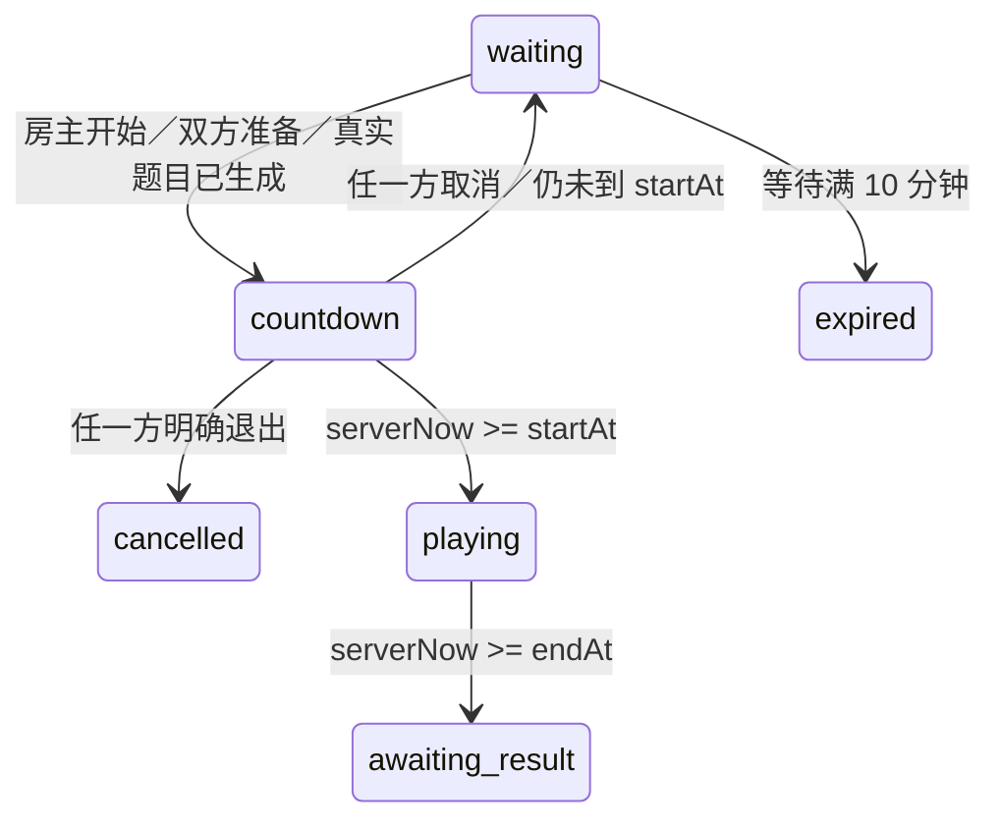

# 房间开赛与取消：组长下一阶段交付

更新：2026-10-31。负责人：袁嘉亮。对应 DP05、FR09／FR11，并为 FR10 的服务端裁判提供批次和私有题目。基于 main `adb4e16836521d38c199d067e250a727c11fe2a1` 开发。

本轮完成房主启动、3 秒统一起点、取消留房清准备、重新开赛的新批次、倒计时退出关闭房间、服务端真实出题与受限读取、客户端未确认请求恢复和开发联调按钮。**未实现答题接收、判分、最终成绩或自动物理清理；不能将本轮描述为完整比赛已完成。**

## 1. 与此前接口的关系

继续使用 `roomService`、现有 cloud1 环境及 `room_p2_rooms`、`room_p2_codes`、`room_p2_requests` 三个集合，客户端仍全部不可直接读写。无需新增集合或放宽权限。已有 waiting 房间、请求编号、身份和错误信封兼容。

`whoami.stage` 更新为 `p4-room-start`；`whoami.data.capabilities` 及 `room.capabilities` 为：

```json
{"start":true,"cancelStart":true,"submitAnswer":false,"finish":false}
```

页面依据能力字段开放功能，不能看到 playing 就假定裁判已经可用。`submitAnswer`、`finish` 继续返回 `FEATURE_NOT_READY`。

本说明补充并覆盖[第一阶段接口](08_组长后端第一阶段交付与接口.md)中关于开赛未实现、room 的空批次和状态字段的描述；其他基础接口继续有效。

## 2. 新增和调整的调用

| action | payload | 规则 |
|---|---|---|
| `start` | `roomId, expectedVersion` | 当前成员为房主、等待未到期、恰好两人且都准备、版本一致；生成题目成功后才设统一起点 |
| `cancelStart` | `roomId, expectedVersion, attemptId` | 任一当前成员；批次匹配、版本一致，服务端处理时尚未到 startAt；取消后留房且双方未准备 |
| `leave`（等待期） | `roomId, expectedVersion` | 原行为：加入者离开释放席位，房主离开关闭房间 |
| `leave`（倒计时期） | `roomId, expectedVersion, attemptId` | 任一方明确退出都关闭房间并丢弃本批次，需另建房间；与 cancelStart 区分 |
| `get` | `roomId` | 当前成员查询；返回当前批次与服务端时间，到 startAt 后返回相同题目；不会返回标准答案 |

所有写操作必须有原规则的 requestId。`room-client.js` 已将 start／cancelStart 加入写请求队列，页面不要自行生成另一套请求编号。

```js
const { createRoomClient } = require('../../utils/room-client');
const client = createRoomClient({ wxApi: wx });
// 放在 async 方法中，调用异常需要 catch 并提示。
const started = await client.call('start', {
  roomId: room.roomId, expectedVersion: room.version
});
room = started.data.room;
// 只在尚未开赛且用户明确取消时执行；取消按钮不等于退出按钮。
const cancelled = await client.call('cancelStart', {
  roomId: room.roomId, expectedVersion: room.version, attemptId: room.attemptId
});
room = cancelled.data.room;
```

不得提交客户端 startAt、endAt、seed、题目、标准答案、分数或身份。未知业务字段被拒绝。attemptId 格式为 `a_` 加 40 位十六进制字符，由服务端生成；不是 requestId 或 roomId。

## 3. 状态与时间



- 题目生成后设 `startAt = 服务端当前时间 + 3000`，`endAt = startAt + 时长`。生成失败、写房间失败或写收据失败，事务不留下半完成的批次。
- `serverNow < startAt` 才能取消；等于或超过 startAt 均拒绝取消、倒计时退出。开赛后的退出／弃权由后续裁判阶段设计，本轮不默认为对方获胜。
- 原创建后 10 分钟等待期限不因取消、轮询或准备改变。临近等待期限开赛后可正常答题到 endAt；若取消时等待期已经到达，则返回 expired，需新建房间。
- `countdown/playing/awaiting_result` 由读取时的服务端时间推导，**阶段可变化但 version 不增加**。页面不能只在 version 变化时刷新状态，也不能把 expiresAt 当比赛截止时间。
- awaiting_result 只表示答题时限已经结束、待裁判接入；没有分数、胜负和最终结果。不要生成本地假成绩填补它。
- 本轮联调页手动刷新。正式页面建议前台每 1 秒查询、操作后立即刷新，后台停止轮询，返回前台先读服务器；倒计时显示可用服务端时间偏差估算，但操作是否接受只能由服务端判断。

## 4. 响应与私有数据

`room` 保留基础字段，新增／启用：

| 字段 | 含义 |
|---|---|
| `attemptId` | 当前有效批次；等待、取消后和关闭为 null |
| `startAt/endAt` | Unix 毫秒；当前批次统一起止；无批次为 null |
| `engineVersion` | 出题器版本，本次为 `1.3.0-room.1`；无批次为 null |
| `config.ruleVersion` | 生成时规则版本，当前 `2026-10-27.1` |
| `questions` | 等待和倒计时为空；到 startAt 后为同题同序数组 |
| `capabilities` | 本轮允许的操作，裁判能力仍为 false |

每个公开题目只有以下白名单字段：

```json
{"id":"q_1","index":1,"ruleId":"g1_add_20","text":"3 + 5 = ?","answerKind":"integer"}
```

这是格式示例。answerKind 还有 decimal、fraction。题号在批次内唯一；后续提交必须同时携带 roomId、attemptId 和题号，不能仅凭 `q_1` 判定所属比赛。

房间内部在开赛时升级 `schemaVersion=2`，存储 `status=active` 和 `attempt`：attemptId、startAt、endAt、ruleVersion、engineVersion、questions。私有 questions 保存精确答案、混合 tokens、分数分子分母、小数十分之一整数等原始参数。公开响应不展开私有对象，查询者无法读取标准答案、其他人的 OPENID 或内部身份。

仅保留当前有效批次，取消会删除该批次私有题目；下一轮新建批次。旧请求收据保留其 `attemptId` 和 `appliedVersion` 供确认。发生重试时，`operation.attemptId` 可能是旧批次，而 `room.attemptId` 是当前批次，**页面始终按 room 渲染，不按旧操作重新启动倒计时**。

房间保留期至少覆盖 endAt 后 24 小时，到期拒绝读取。仍是逻辑访问期限，不是自动物理删除。原房间码的加入有效期仍按等待 expiresAt，不作为开赛中重连凭据；重连应使用已保存 roomId。

## 5. 错误与恢复

| 错误码 | 处理 |
|---|---|
| HOST_ONLY | 仅房主显示启动操作 |
| NEED_TWO_MEMBERS / NOT_ALL_READY | 等待另一成员加入或双方准备 |
| INVALID_STATE | 刷新房间，不在比赛期更改准备或重复发起新开赛 |
| ATTEMPT_MISMATCH | 丢弃旧批次界面，按当前 room 重建显示，不把旧参数换新编号重发 |
| MATCH_ALREADY_STARTED | 隐藏取消／倒计时退出入口；读取当前阶段 |
| VERSION_CONFLICT | 先刷新，重新确认后用新请求编号执行新操作 |
| SERVICE_UNAVAILABLE / CLOUD_CALL_FAILED / INVALID_RESPONSE | 使用 `retryPending()` 原编号原参数重试，不能再发一个 start |
| ROOM_EXPIRED / ROOM_NOT_FOUND | 新建房间；轮询和重连不延长原期限 |

开赛、取消、关闭与写请求收据处于同一事务。重复 start 不重复生成，重复 cancel 不影响后来的新批次。客户端在写请求确认前保留待确认操作，重开页面后仍可恢复。真实数据库并发隔离和真实丢包还需云端双账号测试。

## 6. 出题复用与分工交接

何顺 PR #5 尚待修订，本轮不合并该 PR。仅抽取其已检查的出题纯函数，修复交换顺序加法重复问题后用于服务端；来源提交、差异与后续同步规则见[房间出题模块来源](房间出题模块来源.md)。未复用有小数输入判分问题的 scoring.js。

| 成员 | 下一步怎么接 |
|---|---|
| 闫心如 | 正式房间页调用 start／cancelStart；房主专属开始；两人均可取消；对照 capabilities 和服务端状态控制按钮 |
| 彭方鑫 | 查询恢复时替换当前批次、重建成员准备；旧批次不驱动新倒计时；保留并重试未确认请求，结束前不保存假成绩 |
| 何顺 | 服务端裁判从 `room.attempt.questions` 读取私有原题，核验成员、批次和截止；接受答案后锁定；最终成绩形成前不返回判定或答案 |
| 袁嘉亮 | 更新 roomService，检查接口权限与本轮测试，组织双账号开赛／取消验证，后续复查裁判合入 |

何顺后续的裁判扩展仍需保留本轮的状态、错误和请求去重约定。运行时读到 `active` 内部状态时必须结合 startAt／endAt 判断，不应另建客户端自报分数的通道。

## 7. 已执行验证

- 全部自动检查 **139 项通过**，包含新增开赛边界、重复请求、批次隔离、事务回滚、隐私字段、客户端丢响应恢复及联调页操作。
- 出题独立核算 **13 个题型各 1000 题，共 13000 题**，检查标准答案、范围和交换去重；不等同于何顺 PR 中用户输入判分通过。
- `node scripts/sync-room-contract.cjs --check` 通过。
- 微信工具自带 Node.js **16.13.1** 执行开赛／取消业务冒烟通过；完整测试使用 Node.js 24。
- 联调页 WXML 与全局／页面 WXSS 经微信自带编译器编译通过。
- 袁嘉亮通过网页版控制台上传后确认部署成功；真实微信调用 whoami 已核实 cloud1 返回 `p4-room-start`、start／cancelStart 能力为 true，裁判能力仍为 false。自动部署曾遇到 41002 错误，过程见部署记录。
- 双账号开赛／取消、真实数据库并发、真机断网恢复：**尚待执行**。不能沿用 P2 基础房间的五项通过结论代替本轮验证。

复查命令：`node --test tests/*.test.cjs`。关键用例在 `room-start.test.cjs`、`room-questions.test.cjs`，客户端和联调页回归追加在各自现有测试中。

## 8. 部署与双账号检查

部署状态由实际执行后单独记录在[本轮部署记录](12_开赛后端部署与验证.md)，不要仅凭本地代码判断云端已经更新。

1. 导入本轮代码的 miniapp 目录，在开发者工具选择编译模式“后端联调”。启动页面仍是 `pages/backend-check/backend-check`。
2. 连接 cloud1 后确认身份阶段为 `p4-room-start`。两个账号应不同，用新测试房间开始。
3. A 创建，B 输入六位码加入；两端刷新并依次准备，A 再刷新。A 的“房主开始测试”应可用，B 不可用。
4. A 开始后立即点“取消开始”。若 3 秒内完成，应仍为两人原房间且都未准备；若已到 3 秒，出现 MATCH_ALREADY_STARTED 是正确边界行为，需新房间重测取消。
5. 两端重新准备并再次开始，比较新 attemptId 与上一轮不同。3 秒后两端刷新，确认 startAt/endAt、题目顺序和内容相同；响应不含标准答案。
6. 60 秒后刷新显示 awaiting_result；本阶段没有答题和结算按钮，不填写胜负。
7. 另测倒计时中加入者退出，房间应 cancelled，区别于留房取消；真实丢响应后重试原请求，不能创建第二批次。
8. 记录工具／手机版本、账号是否不同、测试时间和实际结果；第三账号权限与数据库并发另列，不用单机模拟代替。

若新页面仍看不到开赛按钮，先核对导入目录与云端 stage。原 backend 工作区含个人配置未改动，更新后的开发目录见交付消息。
